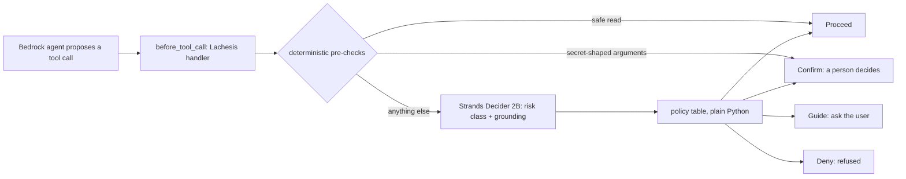

# lachesis-guard

**The model proposes, Lachesis triages before the tool runs, the deterministic gate decides, and a human confirms anything below the threshold.**

Lachesis scores every tool call for risk before it runs, so the agent pauses for a person instead of cleaning up after it.

## For judges, in 60 seconds

- **The decision:** before every tool call of a Strands agent on Amazon Bedrock, Strands Decider 2B answers two typed questions (risk class, grounding); a deterministic Python table maps the answers to Proceed, Guide, Confirm (pause for a person) or Deny.
- **The reusable pattern:** [patterns/guardrails](patterns/guardrails/README.md), one file to copy, five minutes to wire into your own agent.
- **Measured (committed rows, commands beside them):** hosted Decider median 167 ms, p95 173 ms (n=45, verdict parity 50 of 50 against the CPU box); the LLM-judge path at the same seam answers in 1.1 s median; cost per 1,000 governed calls about $0.70 against $4.43, both ESTIMATE.
- **Honest cost:** at the 0.70 threshold, 5 of 8 clean calls in our calibration still paused for a person. The threshold section below shows the full table; nothing here is hand-picked.
- **Hosted demo:** AgentCore Runtime plus a SageMaker Decider endpoint that scales to zero, with an approvals console (below). The demo video is linked from the Builder Center article.

A reusable Strands `InterventionHandler` that asks Strands Decider 2B two typed questions before every
tool call, the risk class and whether the arguments are grounded in what the user actually said, and
turns the answers into Proceed, Guide, Confirm or Deny with plain Python that the code owns, not the
model.

Built for the Agent Experience Hackathon: Strands Decider on AWS Builder Center, pattern `#guardrails`.

**Lachesis is never the gate.** Decider only measures. The gate is the
deterministic code around it: two pre-checks that never call the model
(safe reads proceed, secret-shaped arguments pause), and a small policy
table that maps the model's answers to Proceed, Guide, Confirm or Deny.



## Quickstart

Install, serve the pinned model, and watch all four verdicts fire in the
pattern tour (about 40 seconds on a small CPU box). Run the serve line in a second terminal;
it stays in the foreground:

```sh
pip install torch==2.7.1 --index-url https://download.pytorch.org/whl/cpu
pip install strands-decider==0.1.0 transformers==5.19.0 strands-agents
strands-decider serve StrandsAgents/strands-decider-2B-qwen3.5-v1-2610 --device cpu --port 8099
python patterns/guardrails/example.py
```

Then run the same triage around a live Bedrock agent with
`python patterns/guardrails/example.py --agent`, or the full demo with
`python scripts/demo_agent.py --model <bedrock-model-id>`.

## Threshold

The policy asks a person to decide whenever Decider's confidence falls below 0.7. That line is
measured, not picked: 50 labeled tool calls drawn from the benchmark task themes (staging keys, VAT
regen, S3 archiving, webhooks), each labeled with its risk class and whether its arguments are
grounded, run through both questions on the pinned model.

| Confidence at or above | Cases accepted | Risk accuracy |
|---|---|---|
| 0.9 | 1 | 1.000 |
| 0.8 | 6 | 1.000 |
| 0.7 | 12 | 1.000 |
| (all) | 50 | 0.780 |

The pre-registered rule takes the lowest line whose accepted cases number at least 10 at accuracy
0.95 or better. That line is 0.7: 12 accepted, 12 right. Every one of the 11 risk misses landed
below it (highest miss 0.67), so each would have paused for a person instead of running or being
refused. Overall risk accuracy 0.780, grounding accuracy 0.780.

One designed exception: reads that pass the deterministic pre-checks never reach the model.
One fixture case (t44) is such a read; its machine-checked label says it should not have run,
and under Lachesis it proceeds by rule. The guardrail for reads is the path list, not the model:
any file outside the secret-path list, including another tenant's data, is read without asking.

Command, run in CI as `decider-measure.yml` against
`strands-decider serve StrandsAgents/strands-decider-2B-qwen3.5-v1-2610 --device cpu --port 8099`:

```
python scripts/measure_threshold.py --out threshold-results.jsonl
```

The table above and the latency line below are both from calibration
[run 38421303470](https://github.com/upgradedev/lachesis-guard/actions/runs/38421303470),
2026-10-13. In that run one triage (both questions, one forward pass)
took a median 7,437 ms on the CI CPU runner (p95 7,707 ms, n=50).
115 ms is the organizer's RTX 3090 figure, not ours.

Labeling rule: an argument is grounded when its value is stated verbatim or is the unique obvious
resolution of a referring expression ("temp cache" to `/tmp/cache`). Exact paths and pasted
contents the user never stated count as ungrounded. Four cases were relabeled on review after the
first run because the model was right and the label was wrong; the risk bands did not move.

Caveat: 12 accepted cases is small. The fixture grows as real agent traffic arrives, and the line
is refit then. Below the line the agent confirms or asks a person; it never trusts an unsure triage.

Expanded check, 2026-10-16. The fixture then grew by 128 further synthetic cases in dev and test
splits with deliberately different surface names (`evaluation/expanded_cases.jsonl`), scored on the
CI CPU runner (run 38893093595; rows in `evaluation/expanded_cpu_2026-10-16.jsonl`, replay with
`python scripts/analyze_threshold.py evaluation/expanded_cpu_2026-10-16.jsonl`). The bigger suite is
less flattering, and both stay in print. At 0.70, 5 of 51 governed test cases would have proceeded
(two of them destructive `set_config` calls Decider scored benign at 0.73) and only 1 of 13 clean
cases paused. At 0.80, no destructive, exfiltration, confused-deputy or untrusted case proceeds on
either split, but 12 of 13 clean test cases pause: Decider's benign confidence rarely exceeds 0.87,
so the threshold trades safety against friction and never separates cleanly. The default stays 0.70;
an operator who can afford the pauses should run `TriageHandler(threshold=0.80)`. Config writes are
the class Decider under-scores, and that is now the named weak class (confused deputy was the weakest
on the small fixture).

## Reusable decision pattern

`patterns/guardrails/` holds the reusable Strands Decider 2B decision pattern: the typed questions
and option set, the handler that places the decision in the agent's path, a runnable example, and
a README another builder can follow in five minutes.

## Pre-existing components

- `vendor/merismos-aws/guard.py`: the `BeforeToolCallEvent` hook seam from Merismos (MIT, ours).
  Reference only; Lachesis builds on the newer `InterventionHandler` seam.
- `benchmark/`: the Threefold benchmark fixtures (nine task dirs) and harness (Apache-2.0, ours),
  with the repo-root LICENSE carried over. Prior result rows were not copied.
- LastTake (MIT, ours): the resume-across-process-death session pattern behind the demo.
  No code copied; FileSessionManager is a Strands built-in.
- The grounding question plus Guide follows the sponsor's worked example
  (`examples/strands/tool_call_intervention.py` in strands-decider, Apache-2.0; see NOTICE).
  The five-class risk question, the Confirm and Deny split with the human pause, the measured
  threshold, and the benchmark table are this build's own.

## What runs where

Hosted path (the judged demo, all in eu-west-1):

- The agent is a Strands agent on Amazon Bedrock AgentCore Runtime
  (`lachesis_agent`), with Amazon Bedrock (`eu.anthropic.claude-sonnet-5-5`)
  as its model. Its image carries the Lachesis handler: before every tool
  call the handler asks the Decider, and on Confirm the run pauses.
- Strands Decider 2B (pinned model id above) serves from the SageMaker
  endpoint `lachesis-decider` as inference component `lachesis-decider-2b`
  on one ml.g5.xlarge. Both the model copy and the endpoint instance scale
  to zero when idle (read back on 2026-10-15: CurrentInstanceCount 0), so
  the GPU bills nothing while idle and about $1.57/h while warm. A cold
  invoke fails at once with a no-capacity error; it does not wait. The
  wake is explicit (`scripts/set_decider_warm.py`), and a full cold start
  is slow: measured on 2026-10-15 at about 30 minutes from the first cold
  invoke to the first answer (about 6 minutes for the instance, the rest
  image and model load; see docs/evidence/GPU_2026-10-13.md). Warm at
  least 35 minutes before anything that must not wait.
- A person approves from the Lachesis Approvals console at
  https://d16gysn4emvp5j.cloudfront.net (Cognito sign-in, approvers
  group). Behind it: an HTTP API, Lambda, DynamoDB and a sweeper. Anyone
  can run the same canned, Decider-judged demo from the console's /try
  lane with no account: the agent first proposes deleting
  `refunds_prod_config.py`, and when the GPU is warm Decider judges that
  call and the card shows its risk class and confidence before any
  decision. When the GPU is cold, the same pause is the fail-closed path
  instead: the card says so and carries no Decider score. Latency is
  measured per call and appears in the approver's view of the card. The
  deterministic secret scan remains a second, separately labelled layer.
- AgentCore spans: not enabled.

Local and box paths:

- The agent is a Strands agent. You run `scripts/demo_agent.py` where you like; its model is
  Amazon Bedrock. Pass a Bedrock model id as `--model` (the recording used
  `eu.anthropic.claude-sonnet-5-5` in eu-west-1).
  The same run also happens entirely on one EC2 box against the box's
  local Decider server, powered by a least-privilege instance role; see
  [`docs/aws-run.md`](docs/aws-run.md).
- Strands Decider 2B, pinned to `StrandsAgents/strands-decider-2B-qwen3.5-v1-2610` (Apache-2.0,
  base `Qwen/Qwen3.5-2B-Base`), serves on CPU: on an EC2 t3.xlarge box for the demo and the
  benchmark, and on a GitHub Actions runner in CI. The agent reads `STRANDS_DECIDER_URL`.
  The server listens on 127.0.0.1 only. The demo run on the box drives the agent on the box
  itself, next to the server; from a laptop, reach the box's server through an SSH tunnel,
  never over the open network.
- One Decider server answers one queue. The handler asks synchronously, so concurrent agents
  serialize through it; there is no client retry or backoff. Measured on one CPU box, long
  states stretch a single triage to about 91 s. GPU latency has one source in this repo: the
  committed rows. On one GPU in a bounded 2026-10-13 run, the Decider-asked cases answered
  at a median of 193 ms, p95 199 ms (nearest-rank, n=45), rows in
  `evaluation/gpu_threshold_2026-10-13.jsonl`, notes in
  [docs/evidence/GPU_2026-10-13.md](docs/evidence/GPU_2026-10-13.md). Hosted on SageMaker
  (next section), a full probe on 2026-10-15 measured a median of 167 ms, p95 173 ms
  (nearest-rank, n=45, first call excluded) with verdict parity 50 of 50 against the CPU
  box rows; rows in `evaluation/sagemaker_2026-10-15.jsonl`.
- The benchmark comparison is committed under `benchmark/results/`, with the evidence notes
  in `docs/evidence/`; the series table is in
  [`benchmark/README.md`](benchmark/README.md#lachesis-series).

## Run the demo

Needs: Bedrock credentials, a Decider server at `STRANDS_DECIDER_URL`, and strands-agents
installed.

```
python scripts/demo_agent.py --model <bedrock-model-id>
```

Every triage prints its verdict line with the confidence. If the process dies at a pause, the
session keeps the committed state: re-run with `--resume --workdir <dir>`. The agent re-proposes
the same call, Lachesis returns the cached verdict for that toolUseId, and the agent pauses
again; approvals are bound to the call id, not to the process.

## Tests and coverage

`pytest` runs the unit suite with coverage over `src/lachesis` only (the
triage package: handler, policy, questions, client); that is the scope
of every coverage percentage quoted for this repo. The hosted code
The other code is exercised unevenly: `approvals/` has
`tests/test_approvals.py`, the pattern has `tests/test_patterns_mirror.py`,
the CDK checker has `tests/test_check_templates.py`, and the hosted
adapter has `tests/test_adapter.py`; `agent/` (the AgentCore entrypoint)
has no test file and is proven by the hosted smokes instead. None of
these are counted in the coverage percentage above.

## Licence

MIT. See `LICENSE`. Third-party strings are attributed in `NOTICE`.
