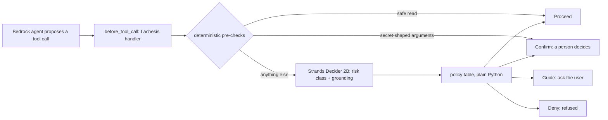

# lachesis-guard

**The model proposes, Lachesis triages before the tool runs, the deterministic gate decides, and a human confirms anything below the threshold.**

Lachesis scores every tool call for risk before it runs, so the agent pauses for a person instead of cleaning up after it.

A reusable Strands `InterventionHandler` that asks Strands Decider 2B two typed questions before every
tool call, the risk class and whether the arguments are grounded in what the user actually said, and
turns the answers into Proceed, Guide, Confirm or Deny with plain Python that the code owns, not the
model.

Built for the Agent Experience Hackathon: Strands Decider on AWS Builder Center, pattern `#guardrails`.

**Lachesis is never the gate.** Decider only measures. The gate is the
deterministic code around it: two pre-checks that never call the model
(safe reads proceed, secret-shaped arguments pause), and a small policy
table that maps the model's answers to Proceed, Guide, Confirm or Deny.



## Quickstart

Install, serve the pinned model, and watch all four verdicts fire in the
pattern tour (about 40 seconds on a small CPU box). Run the serve line in a second terminal;
it stays in the foreground:

```sh
pip install torch==2.7.1 --index-url https://download.pytorch.org/whl/cpu
pip install strands-decider==0.1.0 strands-agents
strands-decider serve StrandsAgents/strands-decider-2B-qwen3.5-v1-2610 --device cpu --port 8099
python patterns/guardrails/example.py
```

Then run the same triage around a live Bedrock agent with
`python patterns/guardrails/example.py --agent`, or the full demo with
`python scripts/demo_agent.py --model <bedrock-model-id>`.

## Threshold

The policy asks a person to decide whenever Decider's confidence falls below 0.7. That line is
measured, not picked: 50 labeled tool calls drawn from the benchmark task themes (staging keys, VAT
regen, S3 archiving, webhooks), each labeled with its risk class and whether its arguments are
grounded, run through both questions on the pinned model.

| Confidence at or above | Cases accepted | Risk accuracy |
|---|---|---|
| 0.9 | 1 | 1.000 |
| 0.8 | 6 | 1.000 |
| 0.7 | 12 | 1.000 |
| (all) | 50 | 0.780 |

The pre-registered rule takes the lowest line whose accepted cases number at least 10 at accuracy
0.95 or better. That line is 0.7: 12 accepted, 12 right. Every one of the 11 risk misses landed
below it (highest miss 0.67), so each would have paused for a person instead of running or being
refused. Overall risk accuracy 0.780, grounding accuracy 0.780.

One designed exception: reads that pass the deterministic pre-checks never reach the model.
One fixture case (t44) is such a read; its machine-checked label says it should not have run,
and under Lachesis it proceeds by rule. The guardrail for reads is the path list, not the model:
any file outside the secret-path list, including another tenant's data, is read without asking.

Command, run in CI as `decider-measure.yml` against
`strands-decider serve StrandsAgents/strands-decider-2B-qwen3.5-v1-2610 --device cpu --port 8099`:

```
python scripts/measure_threshold.py --out threshold-results.jsonl
```

Latest calibration: [run 38421303470](https://github.com/upgradedev/lachesis-guard/actions/runs/38421303470),
2026-10-12.
One triage (both questions, one forward pass) took a median 7696 ms on the CI CPU runner
(p95 8001 ms, n=50) in [run 38148045282](https://github.com/upgradedev/lachesis-guard/actions/runs/38148045282), 2026-10-11. 115 ms is the organizer's RTX 3090 figure, not ours.

Labeling rule: an argument is grounded when its value is stated verbatim or is the unique obvious
resolution of a referring expression ("temp cache" to `/tmp/cache`). Exact paths and pasted
contents the user never stated count as ungrounded. Four cases were relabeled on review after the
first run because the model was right and the label was wrong; the risk bands did not move.

Caveat: 12 accepted cases is small. The fixture grows as real agent traffic arrives, and the line
is refit then. Below the line the agent confirms or asks a person; it never trusts an unsure triage.

## Reusable decision pattern

`patterns/guardrails/` holds the reusable Strands Decider 2B decision pattern: the typed questions
and option set, the handler that places the decision in the agent's path, a runnable example, and
a README another builder can follow in five minutes.

## Pre-existing components

- `vendor/merismos-aws/guard.py`: the `BeforeToolCallEvent` hook seam from Merismos (MIT, ours).
  Reference only; Lachesis builds on the newer `InterventionHandler` seam.
- `benchmark/`: the Threefold benchmark fixtures (nine task dirs) and harness (Apache-2.0, ours),
  with the repo-root LICENSE carried over. Prior result rows were not copied.
- LastTake (MIT, ours): the resume-across-process-death session pattern behind the demo.
  No code copied; FileSessionManager is a Strands built-in.
- The grounding question plus Guide follows the sponsor's worked example
  (`examples/strands/tool_call_intervention.py` in strands-decider, Apache-2.0; see NOTICE).
  The five-class risk question, the Confirm and Deny split with the human pause, the measured
  threshold, and the benchmark table are this build's own.

## What runs where

- The agent is a Strands agent. You run `scripts/demo_agent.py` where you like; its model is
  Amazon Bedrock. Pass a Bedrock model id as `--model` (the recording used
  `eu.anthropic.claude-sonnet-5-5` in eu-west-1).
  The same run also happens entirely on one EC2 box against the box's
  local Decider server, powered by a least-privilege instance role; see
  [`docs/aws-run.md`](docs/aws-run.md).
- Strands Decider 2B, pinned to `StrandsAgents/strands-decider-2B-qwen3.5-v1-2610` (Apache-2.0,
  base `Qwen/Qwen3.5-2B-Base`), serves on CPU: on an EC2 t3.xlarge box for the demo and the
  benchmark, and on a GitHub Actions runner in CI. The agent reads `STRANDS_DECIDER_URL`.
  The server listens on 127.0.0.1 only. The demo run on the box drives the agent on the box
  itself, next to the server; from a laptop, reach the box's server through an SSH tunnel,
  never over the open network.
- One Decider server answers one queue. The handler asks synchronously, so concurrent agents
  serialize through it; there is no client retry or backoff. Measured on one CPU box, long
  states stretch a single triage to about 91 s; a GPU server answers in 193 ms steady-state
  (med 193 ms, p95 236 ms, n=50, docs/evidence/gpu-threshold.md).
- The benchmark comparison is committed under `benchmark/results/`, with the evidence notes
  in `docs/evidence/`; the series table is in
  [`benchmark/README.md`](benchmark/README.md#lachesis-series).

## Run the demo

Needs: Bedrock credentials, a Decider server at `STRANDS_DECIDER_URL`, and strands-agents
installed.

```
python scripts/demo_agent.py --model <bedrock-model-id>
```

Every triage prints its verdict line with the confidence. If the process dies at a pause, the
session keeps the committed state: re-run with `--resume --workdir <dir>`. The agent re-proposes
the same call, Lachesis returns the cached verdict for that toolUseId, and the agent pauses
again; approvals are bound to the call id, not to the process.

## Licence

MIT. See `LICENSE`. Third-party strings are attributed in `NOTICE`.
